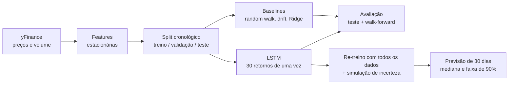
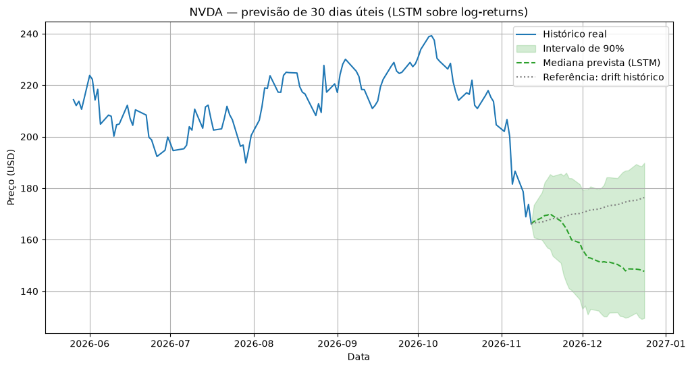
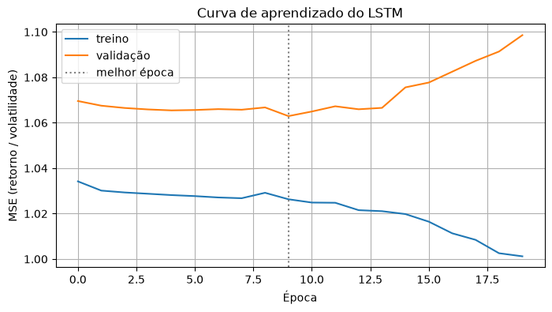
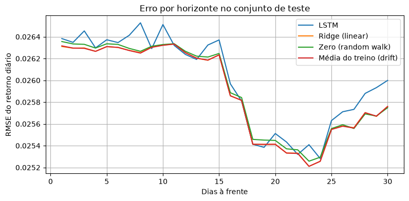

# Previsão de Preços de Ativos com LSTM (Deep Learning)

[](https://colab.research.google.com/github/LorenzoNMachado/Lstm-stock-market-price-forecast/blob/main/stock_market_price_forecast_V4.ipynb)

> **Aviso de isenção de responsabilidade:** este projeto tem finalidade estritamente educacional. Os resultados e previsões não devem ser usados como conselho financeiro ou recomendação de investimento. Modelos de Machine Learning possuem limitações e riscos significativos.

---

## Objetivo do Projeto

Este projeto implementa uma **rede neural recorrente (LSTM)** para projetar o comportamento de um ativo nos **próximos 30 dias úteis** — e, principalmente, **mede com rigor se o modelo realmente tem poder preditivo**, comparando-o com baselines simples em vários períodos de teste.

### Principais resultados (NVDA, 2015–2026)

- O LSTM erra **6,6% menos que o random walk**, mas **não supera o drift** (prever a alta média histórica) nem uma regressão linear — a vantagem vem da tendência da ação, não de padrões aprendidos.
- As features técnicas (médias móveis, RSI, volatilidade, volume) **não mostraram poder preditivo** sobre os próximos 30 dias.
- A previsão final é apresentada como **faixa de 90%**, com aviso automático quando o modelo não supera os baselines.

Detalhes na seção [Resultados](#resultados).

## Como Funciona



---

## Diferenciais Técnicos e Soluções

Diferente de implementações básicas, este projeto foca na **robustez estatística** para evitar erros comuns em previsões financeiras. A versão atual é a **V4** (`stock_market_price_forecast_V4.ipynb`).

### Entradas e alvo estacionários

O modelo prevê **retornos logarítmicos** (log-returns) em vez de preços, e todas as entradas são **relativas**: retornos de 1, 5 e 21 dias, distância do preço às médias móveis (MA7 / MA21), volatilidade, RSI (suavização de Wilder) e volume relativo à média.
Assim, quando o preço atinge níveis nunca vistos no treino, as entradas continuam na mesma faixa conhecida pela rede.

### Treino, validação e teste separados

A divisão é cronológica (70% / 15% / 15%). O `EarlyStopping` usa apenas a validação, e o teste é usado uma única vez, no final. O `StandardScaler` é ajustado **exclusivamente com os dados de treino**, e nenhuma amostra tem alvo que cruze a fronteira entre conjuntos.

### Comparação com baselines

O LSTM é comparado com três modelos de referência — **random walk** (retorno zero), **média histórica** e uma **regressão linear (Ridge)** sobre as mesmas features — usando RMSE dos retornos (1 dia e acumulado em 30 dias) e acerto de direção. Sem essa comparação não dá para saber se o modelo aprendeu algo útil.

### Validação walk-forward

Para o resultado não depender de um único período de teste, os últimos 30% da série são divididos em 4 períodos. Em cada um, scaler e modelos são re-treinados só com os dados anteriores, e as métricas são reportadas por período e na média.

### Previsão direta com intervalo de confiança

O modelo prevê os **30 retornos diários de uma vez** (saída multi-step), sem realimentar a própria previsão. Antes da previsão final ele é re-treinado com todos os dados disponíveis. A incerteza é estimada somando à previsão os erros reais do modelo na validação — centralizados e ajustados à volatilidade atual —, o que gera uma **mediana e uma faixa de 90%** em vez de uma linha única.

---

## Tecnologias Utilizadas

- **Python 3.10–3.12**
- **TensorFlow / Keras** — construção e treinamento da rede neural
- **yFinance** — coleta de dados reais do mercado
- **Pandas & NumPy** — manipulação e tratamento de dados
- **Matplotlib** — visualização de históricos e projeções
- **Scikit-learn** — normalização (`StandardScaler`) e baseline linear (`Ridge`)

## Estrutura do Projeto

```
├── stock_market_price_forecast_V4.ipynb   # versão atual (com resultados salvos)
├── requirements.txt                       # dependências
├── images/                                # gráficos usados neste README
└── archive/                               # versões anteriores (V1–V3)
```

---

## Como Usar

### Opção 1: Google Colab (sem instalar nada)

Clique em [**Abrir no Colab**](https://colab.research.google.com/github/LorenzoNMachado/Lstm-stock-market-price-forecast/blob/main/stock_market_price_forecast_V4.ipynb) e execute todas as células (`Ambiente de execução → Executar tudo`). O Colab já vem com todas as dependências.

### Opção 2: Localmente

Com Python 3.10–3.12:

```bash
git clone https://github.com/LorenzoNMachado/Lstm-stock-market-price-forecast.git
cd Lstm-stock-market-price-forecast
pip install -r requirements.txt
jupyter notebook stock_market_price_forecast_V4.ipynb
```

Se o seu sistema não tem `pip` ou usa uma versão de Python mais nova que a suportada pelo TensorFlow, use o [uv](https://docs.astral.sh/uv/), que baixa o Python certo automaticamente:

```bash
uv venv --python 3.12 && source .venv/bin/activate
uv pip install -r requirements.txt
```

### Reprodutibilidade

Com a variável `END` definida, os dados baixados ficam salvos em `data/` e as sementes aleatórias são fixas, então o resultado é reproduzível. A execução completa leva alguns minutos em CPU; para ir mais rápido, defina `RUN_WALK_FORWARD = False`.

### Personalização (Troca de Ativo)

Para analisar uma empresa diferente, altere a variável `TICKER` no início do código. Você pode usar códigos da NASDAQ, NYSE ou B3 (ex: PETR4.SA para Petrobras).

---

## Resultados

Execução de referência: **NVDA**, de 02/01/2015 a 12/11/2026, rodando em CPU (cerca de 7 minutos). Com a semente fixa, o notebook reproduz exatamente estes números.

### Walk-forward (4 períodos de teste, de mai/2023 a nov/2026)

| Modelo | RMSE retorno 1d | RMSE retorno acumulado 30d | Acerto direção 30d |
|---|---|---|---|
| **Média do treino (drift)** | 0,0285 | **0,1441** | 65,2% |
| Ridge (linear) | 0,0285 | 0,1440 | 65,2% |
| LSTM | 0,0286 | 0,1473 | 65,2% |
| Zero (random walk) | 0,0286 | 0,1577 | — |

**Leitura honesta:**

- O LSTM erra **6,6% menos que o random walk** no retorno de 30 dias, mas erra **cerca de 2% mais que o drift** (simplesmente prever a alta média histórica) e que o Ridge. Ou seja, a vantagem sobre o random walk vem da tendência de alta da ação, não de padrões aprendidos.
- O Ridge escolheu a regularização máxima e virou, na prática, o próprio drift. As features técnicas não têm poder preditivo linear sobre os próximos 30 dias.
- Na curva de aprendizado, a perda de validação quase não cai e começa a subir depois da época 10 — o modelo passa a decorar ruído rapidamente.
- O "acerto de direção" de 65% é igual para LSTM, Ridge e drift: ele reflete principalmente a proporção de períodos de alta no teste, não habilidade de prever a direção.

Isso é consistente com a literatura: retornos de ações são quase imprevisíveis a partir do próprio histórico de preços.

### Previsão dos próximos 30 dias úteis



A mediana do LSTM aponta queda (−11,1%), enquanto o drift histórico aponta alta (+6,1%). Como o LSTM não superou os baselines, o notebook emite um aviso e a leitura correta é a **faixa de 90% (129,54 a 189,83 USD)**, não a linha.

<details>
<summary>Outros gráficos</summary>




</details>

---

## Histórico de Versões

As versões anteriores estão na pasta `archive/`.

- **V1 / V2** — LSTM sobre preços normalizados, previsão direta de 30 dias.
- **V3** — alvo em log-returns e previsão recursiva com indicadores recalculados.
- **V4** — entradas estacionárias, split treino/validação/teste, baselines (incluindo Ridge), walk-forward, previsão direta com intervalo de confiança.

---

## 👤 Autor

**Lorenzo Nakayama Machado**  
Graduando em Ciência da Computação pela Pontifícia Universidade Católica do Paraná (PUCPR).  
Interesse em IA, Ciência de Dados e Desenvolvimento Python.
